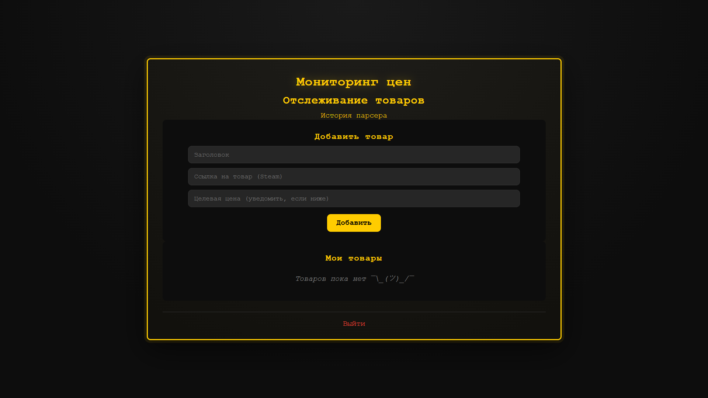

## Интерфейс главной

Сервис для парсинга цен на товары стим.
Пользователь вводит ссылку, и RabbitMQ вокер парсит каждую минуту. Также для особых случаев(ссылка не от стима или она не открывается) есть retry-вокер, а также DLX. Есть возможность просматривать историю парсинга с пагинацией и сортировкой за последние день, неделю, месяц или за все время. В проекте участвует кеширование для оптимизации и асинхронная БД.
Ссылка на сайт: https://steamparser.onrender.com/

## Технологии:
1. Logging
2. RabbitMQ(aio_pika)
3. Redis(redis.asyncio)
4. FastAPI
5. Bcrypt
6. SQLAlchemy[asyncio]
7. Uvicorn
8. Python-jose[cryptography]
9. Pytest-asyncio

## Запуск:
1. Установите файлы
2. Установите библиотеки: pip install --no-cache-dir -r requirements.txt
3. Перейдите в папку
4. Запуск воркера и кеширования:
    1) docker run -d --name rabbitmq -p 5672:5672 rabbitmq:3.13 - запустить брокера
    2) docker run -p 6379:6379 --name redis -d redis:7-alpine - запустить Redis
5. В отдельных терминалах введите:
    1) uvicorn main:app --reload - сайт
    2) uvicorn update_worker:update --reload - отправка непросмотренных ссылок воркеру
    3) uvicorn worker:app --reload - основной воркер
    4) uvicorn retry_worker:app --reload - retry воркер
    5) uvicorn DLX_worker:app --reload - DLX - воркер
6. Запуск ТГ бота(по желанию): python bot.py

## Функции:
1. Ввод ссылки, заголовка для нее и целевую сумму
2. Просмотр истории парсера с пагинацией
3. Удаление ссылки
4. ТГ бот имеет функции входа в аккаунт, выхода из него, просмотра истории с пагинацией

## Переменные Environment:
1. SECRET - придуманный вами пароль для JWT токена
2. ALGORITHM - алгоритм шифрования для JWT токена
3. RABBITMQ_URL - ссылка на воркера
4. REDIS_URL - ссылка на кеширование
5. DATABASE_URL - ссылка на БД
6. TOKEN - токен бота

## Тесты проведены над:
1. Регистрация со свободным и несвободным ником
2. Логин с правильным и неправильным паролем
3. Добавление карточки
4. Просмотр истории

Made by Avdeenkov